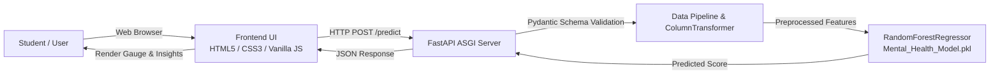

# 🧠 Student Mental Health Prediction & Wellness Analytics

[](https://mental-health-prediction-m0eu.onrender.com/)
[](https://www.python.org/)
[](https://fastapi.tiangolo.com/)
[](https://scikit-learn.org/)
[](https://opensource.org/licenses/MIT)

> An end-to-end Machine Learning web application designed to assess, predict, and analyze student mental health risk scores based on academic workloads, digital device usage patterns, and daily wellness habits.

🔗 **Live Application URL:** [https://mental-health-prediction-m0eu.onrender.com/](https://mental-health-prediction-m0eu.onrender.com/)

---

## 📌 Table of Contents

- [Overview & Motivation](#-overview--motivation)
- [Live Demo & Interface](#-live-demo--interface)
- [Key Features](#-key-features)
- [Machine Learning Architecture](#-machine-learning-architecture)
- [Tools & Technologies Used](#-tools--technologies-used)
- [System Architecture](#-system-architecture)
- [API Documentation](#-api-documentation)
- [Project Directory Structure](#-project-directory-structure)
- [Getting Started Locally](#-getting-started-locally)
- [Deployment on Render](#-deployment-on-render)
- [License](#-license)

---

## 📖 Overview & Motivation

Modern students balance rigorous academic expectations with pervasive digital connectivity. Excessive screen exposure, erratic sleep routines, high stress, and sedentary habits frequently contribute to burnout and diminished cognitive wellbeing.

This project delivers an **AI-powered diagnostic and assessment system** that predicts a student's **Mental Health Score (0 to 10)**. In addition to numeric predictions, it categorizes students into risk tiers (Thriving, Moderate, or Elevated Risk) and generates actionable, personalized wellness recommendations to foster healthier study-life-digital balances.

---

## 🌐 Live Demo & Interface

- **Live URL:** [https://mental-health-prediction-m0eu.onrender.com/](https://mental-health-prediction-m0eu.onrender.com/)
- **Interactive Swagger API Docs:** [https://mental-health-prediction-m0eu.onrender.com/docs](https://mental-health-prediction-m0eu.onrender.com/docs)
- **ReDoc Documentation:** [https://mental-health-prediction-m0eu.onrender.com/redoc](https://mental-health-prediction-m0eu.onrender.com/redoc)

---

## ✨ Key Features

- **Interactive Healthcare UI**: Clean, glassmorphic dashboard built with vanilla HTML5, CSS3, and JavaScript with zero heavy framework bloat.
- **Synchronized Controls**: Bi-directional real-time synchronization between range sliders and numeric input fields.
- **Quick Persona Presets**: One-click scenario simulations:
  - 🌿 *Balanced Scholar* (healthy routines, high score)
  - ⚡ *Exam Crammer* (elevated academic pressure, sleep deficit)
  - 📱 *Digital Fatigue* (excessive screen time, high unlock frequency)
  - 🏃 *Active Student* (high physical activity, balanced lifestyle)
- **Dynamic Visual Feedback**:
  - Animated SVG circular gauge reflecting predicted score in real-time.
  - Color-coded risk spectrum indicator.
  - Multi-tier classification (*Thriving / Low Risk*, *Moderate / Balanced*, *Elevated Risk / Distress*).
- **Personalized Lifestyle Insights**: Factor breakdown bars highlighting sleep adequacy, screen time intensity, study workload, and stress levels with targeted advice.
- **Full REST API with OpenAPI**: Complete Swagger UI documentation available out of the box.

---

## 🤖 Machine Learning Architecture

The model is built and trained using `scikit-learn` in a production-ready unified `Pipeline`:

```
Input Features ────► ColumnTransformer ────► RandomForestRegressor ────► Mental Health Score
                          │
       ┌──────────────────┼──────────────────┬─────────────────┐
       ▼                  ▼                  ▼                 ▼
 [Study Hours]     [Plain Numeric]       [Stress]         [Categorical]
   log1p +           StandardScaler       Ordinal           OneHotEncoder
  StandardScaler     (Age, Usage,         Encoder           (Gender, Platform,
                     Unlocks, Sleep,                        Purpose, Academic,
                     Activity)                              Grouped Countries)
```

### Preprocessing Pipelines
- **Skewed Numeric Feature (`Study_Hours`)**: Logarithmic transformation (`np.log1p`) followed by `StandardScaler` to normalize distribution.
- **Standard Continuous Features (`Age`, `Avg_Daily_Usage_Hours`, `Daily_Unlocks`, `Physical_Activity_Hours`, `Sleep_Hours_Per_Night`)**: Centered and scaled with `StandardScaler`.
- **Ordinal Feature (`Stress_Level`)**: Encoded via `OrdinalEncoder` using discrete categories (`Low` $\to$ `Medium` $\to$ `High` $\to$ `Very High`).
- **Nominal Categorical Features (`Gender`, `Academic_Level`, `Most_Used_Platform`, `Purpose_Of_Use`, `Group_Countries`)**: Encoded using `OneHotEncoder(handle_unknown='ignore')`.

### Model
- **Algorithm:** `RandomForestRegressor`
- **Output:** Continuous mental health assessment score between `0.0` and `10.0`.

---

## 🛠 Tools & Technologies Used

### Machine Learning & Data Science
| Tool | Purpose |
| :--- | :--- |
| **Python 3.11** | Core programming language for data engineering and modeling |
| **Scikit-Learn (1.6.1)** | Feature transformation, preprocessing pipeline, and Random Forest regressor |
| **Pandas** | Tabular data manipulation, cleaning, and transformation |
| **NumPy** | Numerical operations and mathematical transformations |
| **Joblib** | Serialization and loading of the trained scikit-learn pipeline |

### Backend API
| Tool | Purpose |
| :--- | :--- |
| **FastAPI** | High-performance asynchronous web framework for serving the model |
| **Uvicorn** | Lightning-fast ASGI production web server |
| **Pydantic (v2)** | Strict schema validation and data integrity enforcement |
| **Starlette** | Core ASGI toolkit providing file streaming and middleware support |

### Frontend UI / UX
| Tool | Purpose |
| :--- | :--- |
| **HTML5** | Semantic, accessible layout structure |
| **CSS3** | Modern styling featuring CSS variables, gradients, flexbox/grid, and glassmorphism |
| **JavaScript (ES6+)** | Dynamic DOM updates, SVG gauge animation, and async fetch API client |
| **Google Fonts** | Typography using *Plus Jakarta Sans* and *JetBrains Mono* |

### DevOps & Cloud Deployment
| Tool | Purpose |
| :--- | :--- |
| **Render** | Cloud hosting platform powering the live web service container |
| **Git & GitHub** | Version control, CI/CD pipeline triggers, and collaboration |

---

## 🏗 System Architecture



---

## 📡 API Documentation

### 1. Prediction Endpoint
- **URL:** `/predict`
- **Method:** `POST`
- **Content-Type:** `application/json`

#### Request Payload
```json
{
  "age": 21,
  "gender": "Female",
  "country": "USA",
  "academic_level": "Undergraduate",
  "most_used_platform": "YouTube",
  "purpose_of_use": "Education",
  "avg_daily_usage_hours": 2.5,
  "daily_unlocks": 45,
  "study_hours": 5.5,
  "physical_activity_hours": 2.0,
  "sleep_hours_per_night": 8.0,
  "stress_level": "Low"
}
```

#### Successful Response (`200 OK`)
```json
{
  "mental_health_score": 8.25
}
```

### 2. Static Web UI & Health Check
- `GET /` — Serves the interactive assessment frontend dashboard.
- `GET /style.css` — Serves the stylesheet.
- `GET /script.js` — Serves the frontend client logic.
- `GET /docs` — Interactive OpenAPI / Swagger UI.
- `GET /redoc` — Alternative ReDoc API documentation.

---

## 📁 Project Directory Structure

```plaintext
MentalHealthScore/
├── frontend/
│   ├── index.html                 # Single-page application dashboard markup
│   ├── script.js                  # Frontend state, API connector, animations
│   └── style.css                  # Modern glassmorphism UI styles & design system
├── Mental_Health_Model.pkl        # Serialized Scikit-Learn ML pipeline (25.6 MB)
├── Mental_Health_Score.ipynb      # EDA, feature engineering, and model training notebook
├── Student Social Media...csv    # Raw training dataset
├── .gitignore                     # Git exclusion rules (ignores venv, pycache)
├── .python-version                # Pins Python 3.11.9 for Render builds
├── render.yaml                    # Infrastructure-as-code blueprint for Render
├── requirements.txt               # Production Python dependencies
├── run.bat                        # Windows one-click local startup script
├── main.py                        # FastAPI application entrypoint & API logic
└── README.md                      # Comprehensive project documentation
```

---

## 💻 Getting Started Locally

### Prerequisites
- Python 3.11 installed on your system.
- Git installed.

### 1. Clone the Repository
```bash
git clone https://github.com/al-aminh/Mental_Health_Prediction-.git
cd Mental_Health_Prediction-
```

### 2. Create and Activate a Virtual Environment
- **Windows (PowerShell):**
  ```powershell
  python -m venv .venv
  .venv\Scripts\Activate.ps1
  ```
- **macOS / Linux:**
  ```bash
  python3 -m venv .venv
  source .venv/bin/activate
  ```

### 3. Install Dependencies
```bash
pip install -r requirements.txt
```

### 4. Run the Application

**Option A (Windows quick script):**
Double-click `run.bat` or run:
```powershell
.\run.bat
```

**Option B (Uvicorn CLI):**
```bash
uvicorn main:app --reload --host 127.0.0.1 --port 8000
```

### 5. Access the Web App
Open your browser and navigate to:
```
http://127.0.0.1:8000/
```

---

## 🚀 Deployment on Render

This repository includes both a `render.yaml` blueprint and a `.python-version` configuration for zero-friction deployment on [Render](https://render.com).

### Quick Deployment Steps
1. Fork or push this repository to your GitHub account.
2. Sign in to **[dashboard.render.com](https://dashboard.render.com/)**.
3. Click **New +** $\to$ **Web Service**.
4. Connect your GitHub repository.
5. Configure the service settings:
   - **Environment:** `Python 3`
   - **Branch:** `main`
   - **Build Command:** `pip install -r requirements.txt`
   - **Start Command:** `uvicorn main:app --host 0.0.0.0 --port $PORT`
   - **Instance Type:** `Free`
   - **Environment Variables:**
     - Key: `PYTHON_VERSION` | Value: `3.11.9`
6. Click **Deploy Web Service**.

---

## 📄 License

This project is licensed under the **MIT License** — feel free to modify, distribute, and use it for academic and non-commercial purposes.
